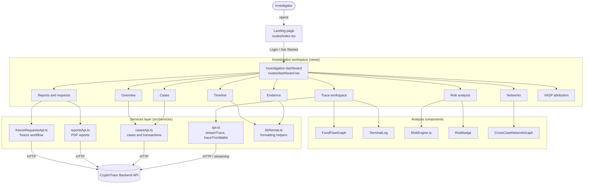

# CryptoTrace — Frontend

> Blockchain Intelligence for Digital Fraud Investigation

CryptoTrace is a digital asset investigation workspace. Investigators trace suspicious cryptocurrency wallets across multiple hops, analyze transaction behavior, compute a risk score, build an evidence ledger, generate reports, and run an auditable freeze-request workflow.

This repository contains the **web frontend**. The API server lives in a separate repository: **[cryptotrace-backend](https://github.com/Mayur-web03/<backend-repo-name>)** *(update the link)*.

---

## Features

- **Multi-hop wallet tracing** on Ethereum (1–10 hops) and TRON (1–5 hops, TRX / TRC20 / all)
- **Live trace terminal** that streams progress while a trace runs
- **Fund-flow graph** visualizing inward and outward transactions per hop
- **Risk analysis**: composite score out of 100 from fan-in/out, velocity, hop depth, error rate, value concentration (and asset diversity on TRON)
- **Timeline and evidence ledger** of every traced transaction
- **Cross-case network** correlation by shared wallet addresses
- **Case management**: create, filter, search and reopen investigations
- **Reports**: download a PDF investigation report per case
- **Freeze-request workflow**: `pending → under_review → approved / rejected → executed`, with a full audit log and PDF export
- **VASP attribution** view (placeholder until a registry is connected)

---

## Architecture



### How a trace flows

1. The investigator picks a network (Ethereum or TRON), enters a wallet and the max hops.
2. `api.ts` calls the backend. Ethereum uses a streaming endpoint (`streamTrace`) and TRON uses `traceTronWallet`.
3. The result (`inward` and `outward` transactions with their hop numbers) is stored in dashboard state.
4. `RiskEngine` computes the score client-side and the score is saved to the case via `updateCase`.
5. The same trace data feeds the graph, timeline, evidence ledger, VASP view and network correlation.

---

## Tech stack

| Area | Tech |
|---|---|
| UI | React + TypeScript |
| Routing | TanStack Router (file-based routes) |
| Icons | lucide-react |
| Styling | Custom CSS (`app-frame`, `panel`, etc.) and inline styles |
| Data | REST + streaming calls to the backend |

---

## Project structure

```
src/
├── routes/
│   ├── index.tsx            # Landing page
│   ├── login.tsx            # Login page (currently bypassed, see note below)
│   └── dashboard.tsx        # Main investigation dashboard
├── components/
│   ├── investigation/       # FundFlowGraph, TerminalLog, ...
│   ├── network/             # CrossCaseNetworkGraph
│   └── shared/              # RiskBadge, RiskBar
├── services/
│   ├── api.ts               # Trace API client (ETH + TRON)
│   ├── casesApi.ts          # Case CRUD and case transactions
│   ├── reportsApi.ts        # PDF report download
│   ├── freezeRequestsApi.ts # Freeze workflow
│   └── risk/RiskEngine.ts   # Risk scoring
├── lib/format.ts            # Date, address, currency helpers
├── data/mock.ts             # Sample data for overview widgets
└── types/                   # Shared TypeScript types
```

---

## Getting started

### Prerequisites

- Node.js 18+
- npm, pnpm or yarn
- The backend running locally or deployed (see the backend repo)

### Install and run

```bash
git clone https://github.com/Mayur-web03/sih.git
cd sih
npm install
npm run dev
```

### Environment variables

Create a `.env` file in the project root and point it to your backend:

```env
# Check src/services/api.ts for the exact variable name used
VITE_API_BASE_URL=http://localhost:8000
```

### Build

```bash
npm run build
```

---

## Authentication note

The login screen has been **bypassed**: the landing page buttons go straight to `/dashboard`, and the `ct_auth` check was removed from `dashboard.tsx`. `login.tsx` is still in the repo only because the generated route tree references it.

For production use, re-enable authentication, for example by restoring a `beforeLoad` guard in `dashboard.tsx`.

---

## Known limitations

- VASP attribution needs an external registry or provider (not yet connected)
- Overview charts and stats use mock data from `data/mock.ts`
- Evidence "Export ledger" is a UI stub
- Freeze requests create an auditable record and PDF only. Actual freezing requires an exchange, custodian or authority integration.

---

## Disclaimer

CryptoTrace only reads public blockchain data and surfaces risk signals. It does not modify the blockchain, store private keys or move funds. All investigative and legal conclusions are made by the human investigator.

---

## Related repositories

- Backend API: `cryptotrace-backend` *(update the link)*
